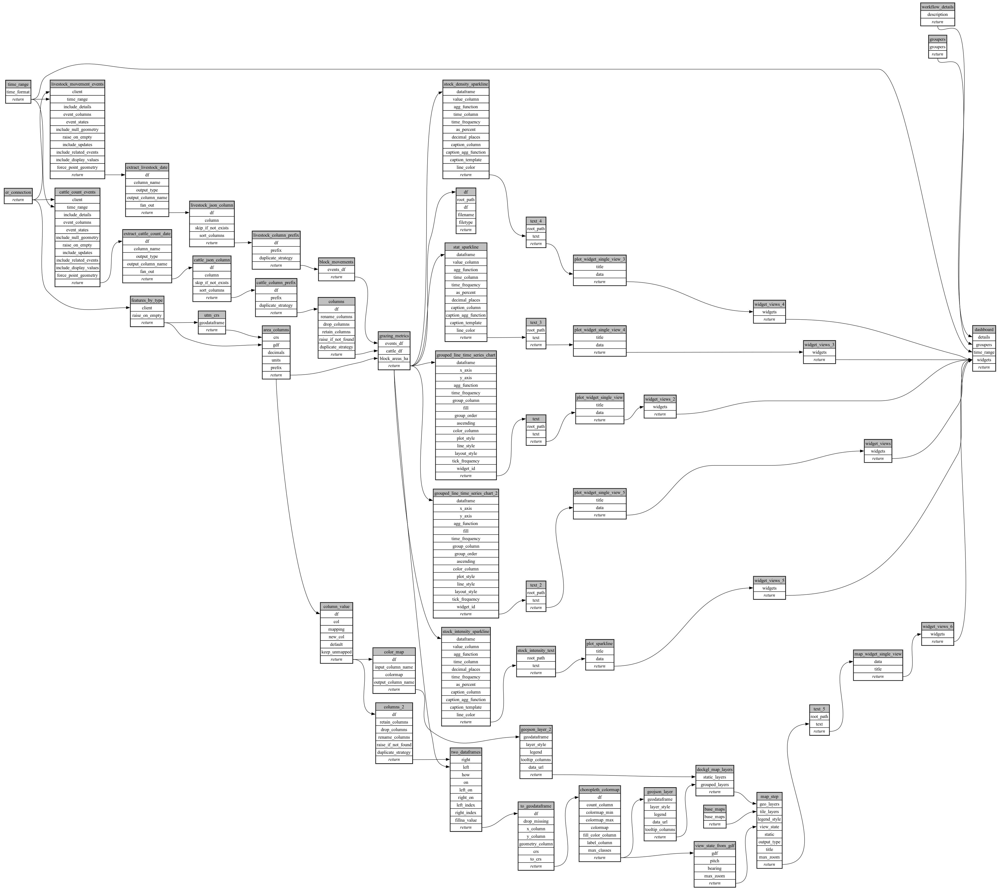

```
# AUTOGENERATED BY ECOSCOPE-WORKFLOWS; see fingerprint in README.md for details

```

```yaml
# fingerprint:
artifacts_sha256_basic: d66a84df9c5207309231235d9b54c9d45484494f349fbaeaa9124539588f8255
artifacts_sha256_strict: b0797d72ae5569ea42884ef45977eef7e90b346859461a30214eebf3059fb40f
installed_requirements:
- channel: https://repo.prefix.dev/ecoscope-workflows/
  name: ecoscope-platform
  version: {version: ==2.28.0}
- channel: https://repo.prefix.dev/ecoscope-workflows-custom/
  name: ecoscope-workflows-ext-custom
  version: {version: ==0.1.5}
- channel: https://repo.prefix.dev/ecoscope-workflows-custom/
  name: ecoscope-workflows-ext-eden
  version: {version: ==0.0.12}
- channel: conda-forge
  name: pydeck
  version: {version: ==0.9.2}
- channel: file:///tmp/ecoscope-workflows-custom/release/artifacts/
  name: ecoscope-workflows-ext-distance-sample-counts
  version: {version: ==1.1.6.dev0+gb9b5e7cf8.d20261111}
- channel: https://repo.prefix.dev/ecoscope-workflows-custom/
  name: ecoscope-workflows-ext-mep
  version: {version: ==1.11.2}
- channel: https://repo.prefix.dev/ecoscope-workflows-custom/
  name: ecoscope-workflows-ext-wwf-virunga
  version: {version: ==1.0.1}
- channel: https://repo.prefix.dev/ecoscope-workflows-custom/
  name: ecoscope-workflows-ext-ste
  version: {version: ==0.0.34}
params_sha256: a624012784171228f066612ab7486d138a909a3c35b45bab82413f02857bd867
spec_sha256: c139156e59b8d0c7ca421d9db6ba2aa77a078122df401a33bc38dadae144c1ea

```

# ecoscope-workflows-livestock-grazing-intensity-workflow


